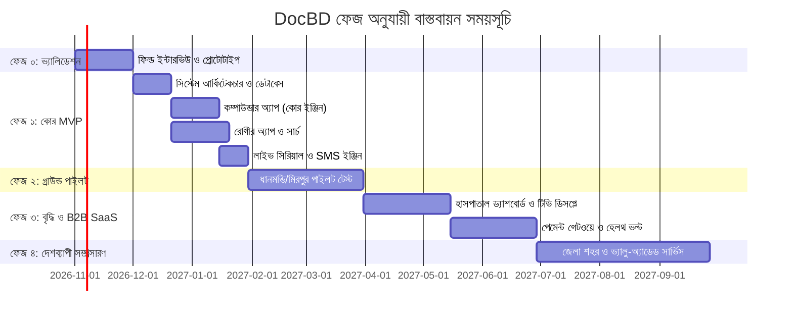

# DocBD — ফেজ অনুযায়ী বাস্তবায়ন ও স্প্রিন্ট প্ল্যান (Phase-by-Phase Execution Plan)
**প্রজেক্ট:** DocBD (কাছের ডাক্তার, আসল সিরিয়াল, অপেক্ষা ছাড়া)  
**মাস্টার রেফারেন্স:** [DOCBD_MASTER_PLAN.md](file:///c:/Innovation/DocBD/DOCBD_MASTER_PLAN.md)

---

## 📌 ফেজসমূহের টাইমলাইন এক নজরে



---

## ফেজ ০: ভ্যালিডেশন ও ক্লিকযোগ্য প্রোটোটাইপ
> **সময়কাল:** ১ মাস (সপ্তাহ ১ – ৪)  
> **মূল উদ্দেশ্য:** এক লাইন কোড লেখার আগেই মাঠপর্যায়ে ডাক্তার, কম্পাউন্ডার ও হাসপাতালের বাস্তবিক চাহিদা ও আপত্তি যাচাই করা।

### ১. প্রধান ডেলিভারেবলস (Deliverables):
- **ফিল্ড ইন্টারভিউ কোয়েশ্চেনারি:**
  - ডাক্তারদের জন্য: চেম্বারের সময় ব্যবস্থাপনা, নো-শো সমস্যা, এবং সহকারী নির্ভরতা নিয়ে প্রশ্ন।
  - কম্পাউন্ডারদের জন্য: প্রতিদিনের খাতার ঝামেলা, রোগী সামলানোর চাপ, এবং ফোন বুকিংয়ের উপায়।
  - ক্লিনিক পরিচালকদের জন্য: ভিড় নিয়ন্ত্রণ, হিসাবের স্বচ্ছতা ও সফটওয়্যার ব্যবহারের অনীহার কারণ।
- **ইন্টারেক্টিভ ক্লিকযোগ্য প্রোটোটাইপ (UI/UX Mockups):**
  - **কম্পাউন্ডার অ্যাপ:** বড় বোতামে সিরিয়াল কলিং স্ক্রিন, দ্রুত ওয়াক-ইন এন্ট্রি।
  - **রোগীর অ্যাপ:** ম্যাপে ডাক্তার খোঁজা, খালি স্লট নির্বাচন, লাইভ সিরিয়াল কার্ড।
- **পাইলট হাসপাতাল সমঝোতা (LOI):**
  - ধানমন্ডি বা মিরপুরের ২-৩টি মাঝারি হাসপাতাল/ক্লিনিকের সাথে প্রাথমিক চুক্তি।

### ২. দায়িত্ব বণ্টন:
- **ফাউন্ডার / প্রোডাক্ট লিড:** সরাসরি হাসপাতাল ভিজিট, ডাক্তারদের সাক্ষাৎকার গ্রহণ ও পার্টনারশিপ আলোচনা।
- **UI/UX ডিজাইনার:** মোবাইল-ফার্স্ট বাংলা ইন্টারফেস ও ক্লিকযোগ্য প্রোটোটাইপ তৈরি।

### 🎯 পরবর্তী ধাপে যাওয়ার শর্ত (Gate 0):
- **অন্তত ২টি হাসপাতাল বা ডায়াগনস্টিক সেন্টারের আনুষ্ঠানিক লিখিত সম্মতি (Letter of Intent)।**

---

## ফেজ ১: কোর MVP ডেভেলপমেন্ট (Core Product Build)
> **সময়কাল:** ৩ মাস (সপ্তাহ ৫ – ১৬)  
> **মূল উদ্দেশ্য:** একটি নির্ভরযোগ্য, অফলাইন-সাপোর্টেড কম্পাউন্ডার অ্যাপ এবং রোগীর জন্য নির্ভুল লাইভ সিরিয়াল ট্র্যাকিং অ্যাপ তৈরি।

```
┌────────────────────────────────────────────────────────┐
│                   ফেজ ১: MVP আর্কিটেকচার                │
│                                                        │
│  [Patient App] ──(Search & Book)──┐                    │
│                                   ▼                    │
│  [Compounder App] ──(Next/Done)─► [Fastify Backend]    │
│         ▲                               │              │
│   (Offline Sync)                        ▼              │
│                                   [Redis Pub/Sub]      │
│                                         │              │
│                       ┌─────────────────┴─────────────┐│
│                       ▼                               ▼│
│                [Live WebSocket]                [SSL SMS]│
│            ("এখন ৫ নম্বর ভেতরে")            (কনফার্মেশন)│
└────────────────────────────────────────────────────────┘
```

### স্প্রিন্ট ১ ও ২ (সপ্তাহ ৫ – ৮): ব্যাকএন্ড ভিত্তি ও ডেটাবেস
- **টেক স্ট্যাক:** Node.js (Fastify), PostgreSQL + PostGIS, Prisma ORM, Redis।
- **ডেটা মডেল:**
  - `User`, `Doctor`, `Hospital`, `Chamber`, `Schedule`, `BookingSerial`, `QueueLog`।
- **নিরাপত্তা ও অথেনটিকেশন:**
  - পাসওয়ার্ডবিহীন মোবাইল নম্বর + ৬ ডিজিট OTP লগইন।
  - SSL Wireless / Greenweb SMS গেটওয়ে ইন্টিগ্রেশন।

### স্প্রিন্ট ৩ ও ৪ (সপ্তাহ ৯ – ১২): কম্পাউন্ডার অ্যাপ (সিস্টেমের চাবিকাঠি)
- **টেক স্ট্যাক:** React Native (Expo) — কমদামী অ্যান্ড্রয়েড ফোনের উপযোগী হালকা ফ্রেমওয়ার্ক।
- **ফিচারসমূহ:**
  - **সমন্বিত সিরিয়াল তালিকা:** অনলাইন, টেলিফোন ও ওয়াক-ইন সব রোগী এক তালিকায়।
  - **অ্যাকশন বোতাম:** `পরবর্তী রোগী ডাকুন`, `ভিজিট সম্পন্ন`, `রোগী অনুপস্থিত (No Show)`, `পরে ডাকুন`।
  - **জরুরি রোগীকে আগে ঢোকানো:** কারণ লিখে তাৎক্ষণিক ইমার্জেন্সি সিরিয়াল পুশ।
  - **ক্যাশ পেমেন্ট ও SMS রসিদ:** নগদ টাকা গ্রহণ এবং রোগীর মোবাইলে ডিজিটাল রসিদ পাঠানো।
  - **অফলাইন মোড:** SQLite ক্যাশিং; নেট চলে গেলেও সিরিয়াল চালানো যাবে, নেট আসলে সিঙ্ক হবে।
  - **ডাক্তার বিলম্ব ব্রডকাস্ট:** এক ক্লিকে চেম্বারের সব রোগীকে বিলম্বের কারণ সহ SMS পাঠানো।

### স্প্রিন্ট ৫ ও ৬ (সপ্তাহ ১৩ – ১৬): রোগীর মোবাইল অ্যাপ ও লাইভ সিরিয়াল ইঞ্জিন
- **টেক স্ট্যাক:** React Native / Expo + PWA সংস্করণ।
- **ফিচারসমূহ:**
  - **GPS ম্যাপ ও সার্চ:** কাছের হাসপাতাল, ক্লিনিক ও ডাক্তার খোঁজা (দূরত্ব ও আনুমানিক সময় সহ)।
  - **ফিল্টার:** "আজকেই দেখা যাবে", স্পেশালিটি, এলাকা, ও BMDC ভেরিফাইড ব্যাজ।
  - **বুকিং ফ্লো:** খালি সিরিয়াল দেখে তাৎক্ষণিক বুকিং, ডিজিটাল টোকেন স্লিপ।
  - **লাইভ সিরিয়াল স্ক্রিন:** WebSocket-এর মাধ্যমে রিয়েল-টাইম আপডেট: *"এখন ৫ নম্বর ভেতরে, আপনার ১২, আনুমানিক সময় রাত ৮:২০–৮:৩৫"*।
  - **স্মার্ট চেক-ইন প্রম্পট:** হাসপাতালের কাছে এলে নোটিফিকেশন, রোগী বোতাম চাপবেন *"আমি পৌঁছেছি"*।

### 🎯 পরবর্তী ধাপে যাওয়ার শর্ত (Gate 1):
- **পাইলট হাসপাতালে মোট সিরিয়ালের অন্তত ৩০% সফলভাবে DocBD অ্যাপের মাধ্যমে পরিচালিত হওয়া।**

---

## ফেজ ২: গ্রাউন্ড পাইলট — এলাকাভিত্তিক মাঠপর্যায়ের পরীক্ষা
> **সময়কাল:** ২ মাস (সপ্তাহ ১৭ – ২৪)  
> **এলাকা:** ধানমন্ডি বা মিরপুর ক্লাস্টার  
> **মূল উদ্দেশ্য:** বাস্তব চেম্বারের পরিবেশে সফটওয়্যার চালিয়ে কম্পাউন্ডার ও ডাক্তারদের অভ্যাস তৈরি এবং ত্রুটি সংশোধন।

### প্রধান কার্যক্রম:
1. **অন-সাইট অনবোর্ডিং:**
   - পাইলট হাসপাতালের রিসেপশন ও চেম্বারে গিয়ে কম্পাউন্ডারদের হাতে-কলমে প্রশিক্ষণ দেওয়া।
   - প্রয়োজনে চেম্বারে একটি ডেডিকেটেড কমদামী অ্যান্ড্রয়েড ট্যাবলেট সরবরাহ করা।
2. **কম্পাউন্ডার প্রণোদনা চালু:**
   - সঠিক সময়ে ও নির্ভুলভাবে সিরিয়াল কল ও শেষ করার জন্য কম্পাউন্ডারদের মাসিক নগদ বোনাস প্রদান।
3. **সহজ মোড (Easy Mode) পরীক্ষা:**
   - প্রবীণ ও সাধারণ রোগীদের জন্য বড় ফন্ট, খাঁটি বাংলা ও ভয়েস গাইডের কার্যকারিতা যাচাই।
4. **মেট্রিক্স পর্যবেক্ষণ:**
   - নো-শো হার কতটা কমল, রোগীরা কতক্ষণ আগে পৌঁছাচ্ছেন, এবং সিরিয়াল অনুমানের নির্ভুলতা ট্র্যাকিং।

### 🎯 পরবর্তী ধাপে যাওয়ার শর্ত (Gate 2):
- **নো-শো হার ১৫%-এর নিচে নেমে আসা এবং ৯০%+ ডাক্তারের সিস্টেম চালিয়ে যাওয়ার লিখিত সম্মতি।**

---

## ফেজ ৩: বৃদ্ধি ও B2B SaaS প্ল্যাটফর্ম
> **সময়কাল:** ৪ মাস (সপ্তাহ ২৫ – ৪০)  
> **মূল উদ্দেশ্য:** হাসপাতালগুলোর জন্য সেন্ট্রাল ম্যানেজমেন্ট পোর্টাল, ওয়েটিং রুম টিভি এবং ডিজিটাল পেমেন্ট চালু করে রাজস্ব আয় শুরু করা।

### ১. প্রধান ডেলিভারেবলস:
- **হাসপাতাল ও ক্লিনিক ড্যাশবোর্ড (Next.js Web Portal):**
  - একাধিক ডাক্তারের চেম্বার রোস্টার, স্টাফ অ্যাকাউন্ট ও রোল পারমিশন।
  - সেন্ট্রাল অ্যানালিটিক্স: ভিড়ের সময়, নো-শো রেট ও বিভাগভিত্তিক রোগীর চাপ।
  - হাসপাতালের ওয়েবসাইট ও ফেসবুক পেজের জন্য এমবেডেবল বুকিং উইজেট।
- **ওয়েটিং রুম টিভি ডিসপ্লে (Smart TV Web View):**
  - ওয়েটিং রুমে থাকা টিভিতে ফুলস্ক্রিনে কোন ডাক্তারের কত নম্বর সিরিয়াল চলছে তা ব্রডকাস্ট করা।
- **হেলথ ভল্ট ও ডিজিটাল রিপোর্ট:**
  - ফ্যামিলি মেম্বার প্রোফাইল (বাবা-মা, সন্তান)।
  - হাসপাতাল থেকে সরাসরি রোগীর অ্যাপে ডায়াগনস্টিক রিপোর্ট পুশ করা (SMS অ্যালার্ট সহ)।
  - প্রেসক্রিপশন সেভ ও ওষুধের ডোজ অ্যালার্ম।
- **ডিজিটাল পেমেন্ট ইন্টিগ্রেশন:**
  - bKash Tokenized Checkout, Nagad Direct ও SSLCommerz (ক্যাশ-অ্যাট-চেম্বার ডিফল্ট রেখেই)।
- **B2B সাবস্ক্রিপশন বিলিং:**
  - ফ্রি, ডক্টর প্রো, ক্লিনিক ও এন্টারপ্রাইজ প্যাকেজ বিলিং ইঞ্জিন চালু।

### 🎯 পরবর্তী ধাপে যাওয়ার শর্ত (Gate 3):
- **২০টি পেইড ক্লিনিক/হাসপাতাল অনবোর্ড হওয়া এবং মাসে ৫০,০০০+ সফল সিরিয়াল সম্পন্ন হওয়া।**

---

## ফেজ ৪: দেশব্যাপী সম্প্রসারণ ও ভ্যালু-অ্যাডেড সেবা
> **সময়কাল:** চলমান (সপ্তাহ ৪১+)  
> **মূল উদ্দেশ্য:** ঢাকার বাইরে আঞ্চলিক হাব তৈরি এবং ইকোসিস্টেম পার্টনারশিপ বৃদ্ধি।

### প্রধান কার্যক্রম:
- **আঞ্চলিক নেটওয়ার্ক সম্প্রসারণ:**
  - চট্টগ্রাম, সিলেট, রাজশাহী, খুলনা ও অন্যান্য প্রধান জেলা শহরে ফিল্ড টিম নামানো।
- **টেলিমেডিসিন ফলো-আপ (ঐচ্ছিক):**
  - শারীরিক চেম্বার ভিজিটের পর ফলো-আপ পরামর্শের জন্য অ্যাপের ভেতরেই হালকা অডিও/ভিডিও কলিং (WebRTC / Agora)।
- **পার্টনারশিপ ইন্টিগ্রেশন:**
  - অনুমোদিত হোম-ডেলিভারি ফার্মেসির সাথে ওষুধ অর্ডার এবং ডায়াগনস্টিক ল্যাব টেস্ট হোম-স্যাম্পল বুকিং।
- **হসপিটাল ইনফরমেশন সিস্টেম (HIS) API:**
  - বড় হাসপাতালের নিজস্ব সফটওয়্যারের সাথে DocBD-র রিয়েল-টাইম বাই-ডিরেকশনাল ডেটা সিঙ্ক।

### 🎯 ফেজ ৪-এর সাফল্যের মাপকাঠি:
- **ঢাকা ও চট্টগ্রামের বাইরে ৫টি প্রধান জেলা শহরে ১০০+ পার্টনার স্বাস্থ্য প্রতিষ্ঠান এবং মাসে ২,০০,০০০+ বুকিং সম্পন্ন করা।**
